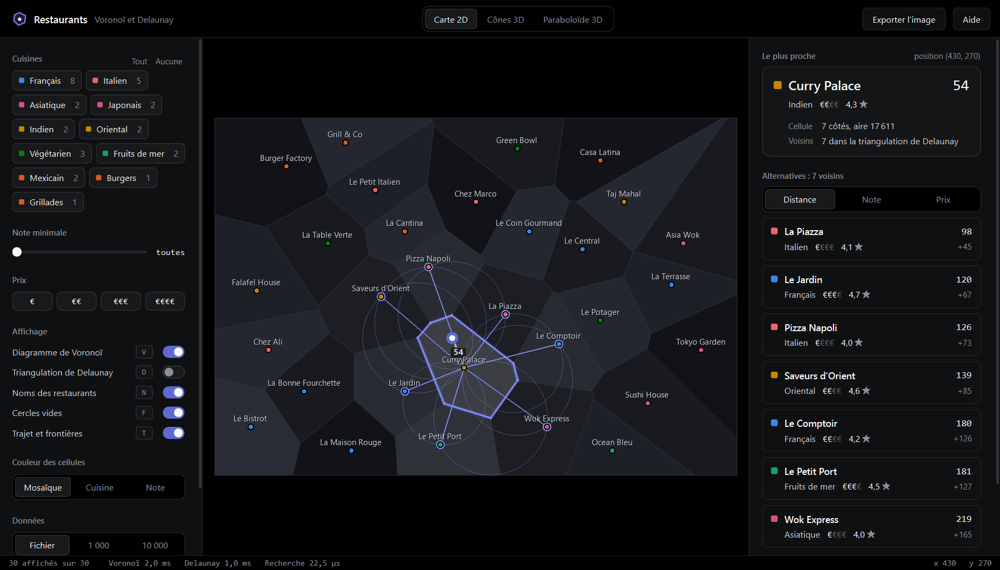
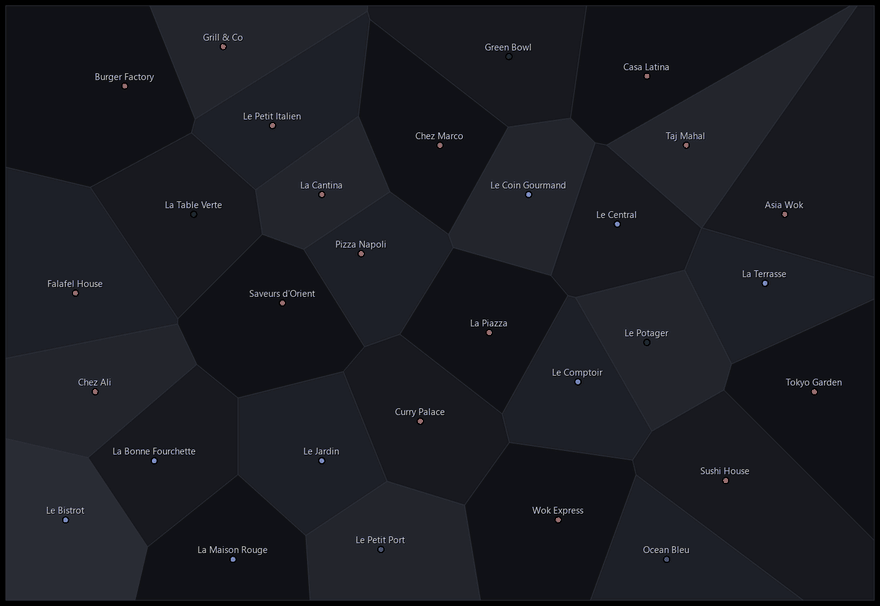
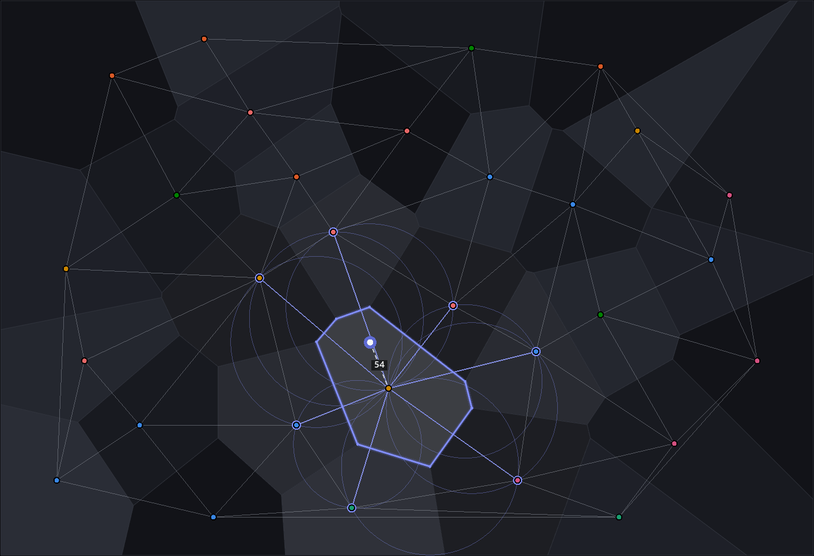
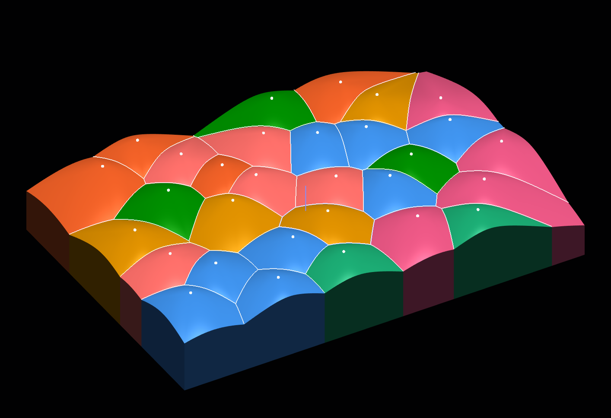
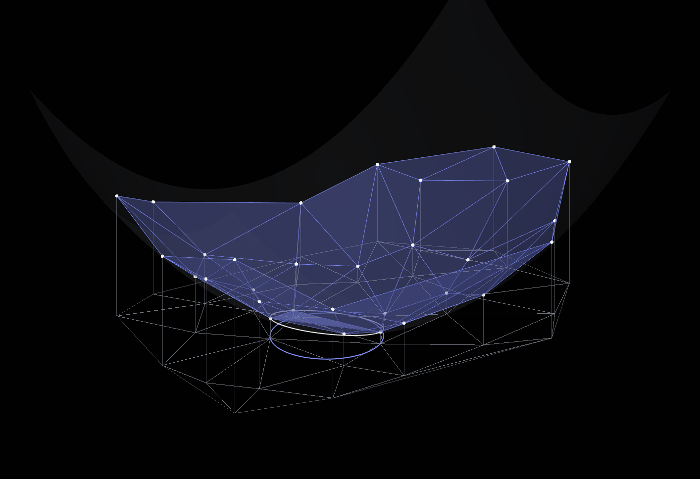
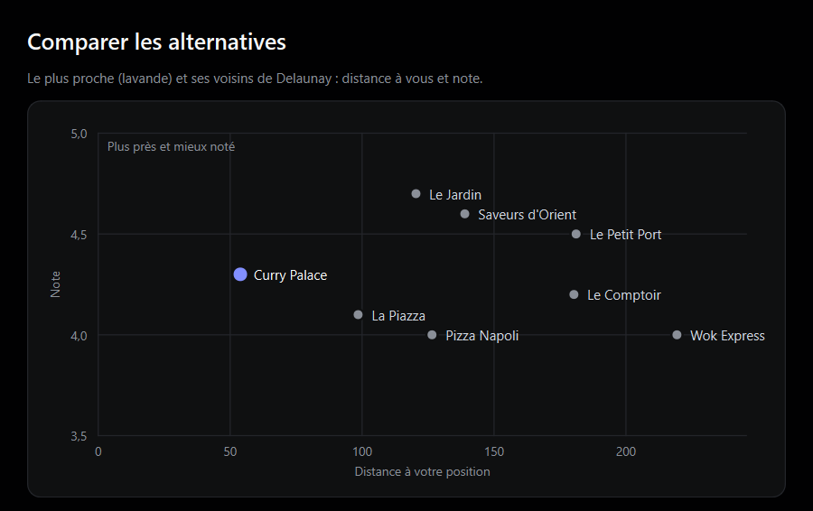
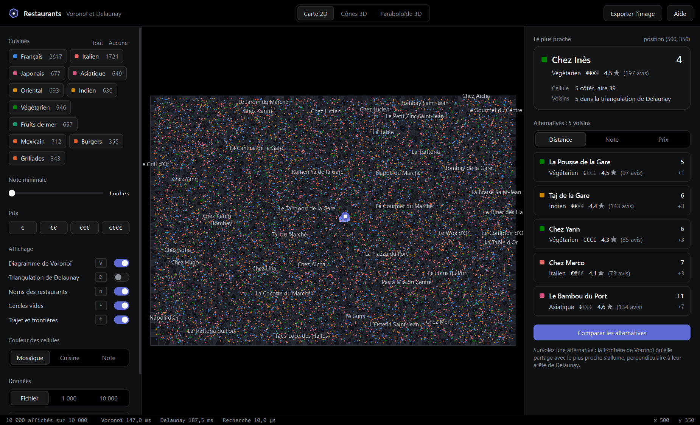
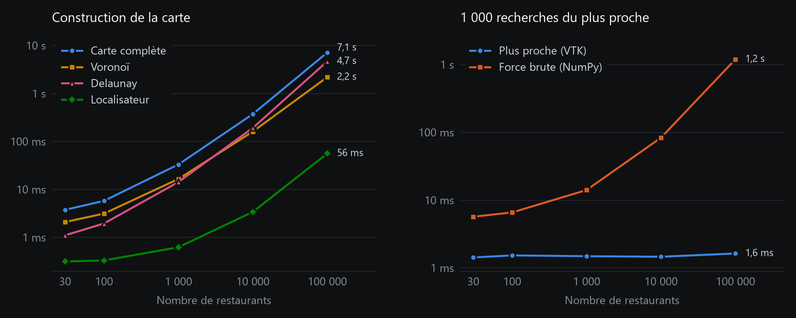

<h1 align="center">Restaurants : Voronoï et Delaunay</h1>

<p align="center">
  Trouver d'un clic le restaurant le plus proche, et ses meilleures alternatives, grâce à la géométrie algorithmique.
</p>

<p align="center">
  Projet universitaire · Master 1 Informatique et Mobilité, Université de Haute-Alsace<br>
  Module « Algorithmique géométrique appliquée à l'image » · Réalisé par Moundir Houazar
</p>

<p align="center">
  
</p>

On clique n'importe où sur la carte : l'application trouve aussitôt le restaurant le plus proche et propose ses
voisins comme alternatives. Derrière ce geste, deux structures classiques de la géométrie algorithmique : le
**diagramme de Voronoï**, qui découpe le plan en zones d'influence, et la **triangulation de Delaunay**, son dual,
qui relie les restaurants voisins. Les deux sont calculés avec VTK, et l'interface est écrite avec PySide6.

## Démonstration

<p align="center">
  
</p>

Un clic place votre position. En glissant, chaque frontière de Voronoï franchie est marquée sur le trajet et
annoncée. Survoler une alternative éclaire la frontière qu'elle partage avec le plus proche, et un clic sur elle
vous y emmène.

## Le principe

<table>
  <tr>
    <td width="50%" valign="top">
      
      <br><b>Voronoï : le plus proche.</b> Chaque restaurant possède une cellule, formée des points plus proches
      de lui que de tout autre. Le plus proche d'un clic est donc celui dont la cellule contient ce clic.
    </td>
    <td width="50%" valign="top">
      
      <br><b>Delaunay : les voisins.</b> Deux restaurants sont voisins quand leurs cellules se touchent. Ces liens
      forment la triangulation de Delaunay, dont aucun cercle circonscrit ne contient de restaurant.
    </td>
  </tr>
  <tr>
    <td width="50%" valign="top">
      
      <br><b>Cônes de distance.</b> Chaque restaurant porte un cône qui descend quand on s'en éloigne. Vu de
      dessus, le cône le plus haut est celui du plus proche : on retrouve exactement le Voronoï.
    </td>
    <td width="50%" valign="top">
      
      <br><b>Relèvement sur un paraboloïde.</b> Chaque restaurant (x, y) monte à la hauteur x² + y². Les faces
      du dessous de l'enveloppe convexe, projetées à plat, donnent la triangulation de Delaunay.
    </td>
  </tr>
</table>

## Fonctionnalités

Les cinq parties du sujet et les quatre extensions sont traitées.

- **Recherche** : un clic allume la cellule du restaurant le plus proche et affiche sa distance.
- **Alternatives** : les voisins de Delaunay, triables par distance, note ou prix.
- **Déplacement** : à la souris ou au clavier, le trajet est tracé et chaque frontière franchie est signalée.
- **Filtres** : cuisine, note minimale et prix ; le diagramme est recalculé sur les restaurants gardés.
- **Comparaison** : un nuage distance / note et un tableau des alternatives.
- **Passage à l'échelle** : 1 000 ou 10 000 restaurants générés, avec les temps de calcul affichés.

<table>
  <tr>
    <td width="50%" valign="top">
      
      <br><b>Comparer les alternatives</b> selon la distance et la note.
    </td>
    <td width="50%" valign="top">
      
      <br><b>10 000 restaurants</b> : la carte se construit en 0,4 s environ.
    </td>
  </tr>
</table>

## Installation et lancement

Il faut Python 3.10 ou plus récent.

```bash
python -m pip install -r requirements.txt
python app.py
```

Pour ouvrir un autre fichier : `python app.py mon_fichier.csv`. Les colonnes `ID,nom,X,Y` sont obligatoires,
`type,prix,note,avis` facultatives, avec `,` ou `;` comme séparateur.

## Commandes

| Action | Souris | Clavier |
|---|---|---|
| Placer sa position | clic | Entrée (centre de la carte) |
| Se déplacer | glisser | flèches (Maj pour aller vite) |
| Zoomer, déplacer la carte | molette, clic droit | |
| Calques Voronoï, Delaunay, noms, cercles vides, trajet | panneau de gauche | V, D, N, F, T |
| Changer de vue | barre du haut | 1, 2, 3 |
| Effacer, aide | | Échap, F1 |

## Performances

<p align="center">
  
</p>

Construire la carte prend 0,4 s pour 10 000 restaurants et 7 s pour 100 000. Ensuite, 1 000 recherches du plus
proche coûtent environ 1,5 ms quelle que soit la taille, alors que la force brute passe de 6 ms à 1,2 s. Pour
refaire les mesures : `python bench.py`.

## Tests

```bash
python app.py --test
```

Les 33 tests vérifient notamment que la recherche donne le même résultat que la force brute sur 40 000
positions, que chaque triangle a un cercle circonscrit vide, que Voronoï et Delaunay sont bien duaux, et que le
cône le plus haut est celui du restaurant le plus proche.

## Organisation du code

| Fichier | Rôle |
|---|---|
| `app.py` | point d'entrée |
| `geometrie.py` | lecture du CSV, Voronoï, Delaunay, recherche, voisins, franchissements |
| `scenes3d.py` | géométrie des cônes et du paraboloïde |
| `vues.py` | rendu VTK des trois vues |
| `interface.py`, `theme.qss` | fenêtre PySide6 et thème sombre |
| `bench.py` | mesures de performance |
| `data/restaurants.csv` | les 30 restaurants fournis |
